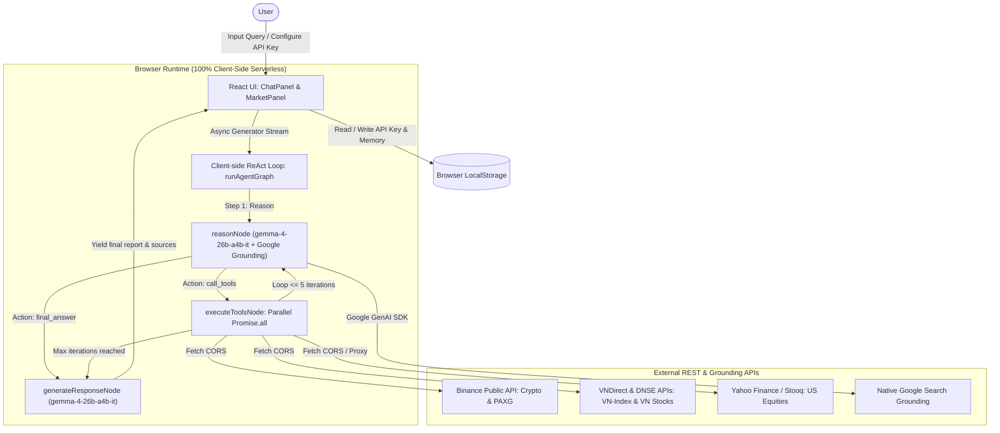

# Architecture: Chat Finance Agentic System 🤖📈

This document provides a detailed overview of the core architecture behind **Chat Finance** — a serverless, agentic financial dashboard powered by **Gemma 4 (`gemma-4-26b-a4b-it`)**, **React 18**, **Vite**, **TypeScript**, and hosted on **Cloudflare Workers**.

---

## 🏗️ Core Architecture Overview

---

## 🛠️ Key Technologies

- **Large Language Model**: [Gemma 4 (`gemma-4-26b-a4b-it`)](https://ai.google.dev) via official `@google/genai` TypeScript SDK.
- **Search & Reasoning**: Native Google Search Grounding + High Thinking Level.
- **Frontend Framework**: React 18, TypeScript, Vite 6.
- **Styling**: Vanilla CSS Glassmorphism Dark Mode Terminal.
- **Charting**: TradingView Embedded Live Technical Chart.
- **Edge Hosting**: Cloudflare Workers (Static Assets SPA).

---

## 🔄 Agentic Execution Flow

1. **Intake & Context Restoration**:
   - The user query is recorded in `ConversationMemory` (persisted in `localStorage`).
   - The last exchanges are formatted and injected into the prompt context along with real-time timestamp information.

2. **Reasoning (`reasonNode`)**:
   - Evaluates the query or tool results from preceding iterations.
   - Leverages `gemma-4-26b-a4b-it` to decide whether external data is required.
   - Extracts native thoughts and Google Search citations in real time.

3. **Execution (`executeToolsNode`)**:
   - Resolves tool calls concurrently using `Promise.all()`.
   - Normalizes input parameters and enforces resilience with try-catch blocks and API fallbacks.

4. **Synthesis (`generateResponseNode`)**:
   - When all required tools finish or when max iterations (5) are hit, synthesizes a structured Markdown report with source citations.
